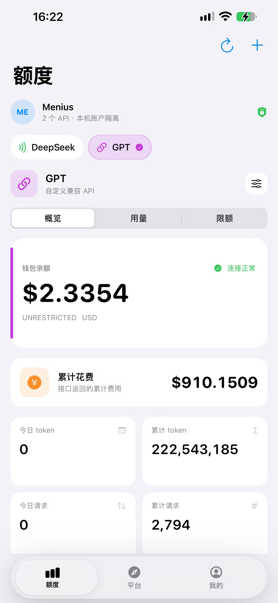
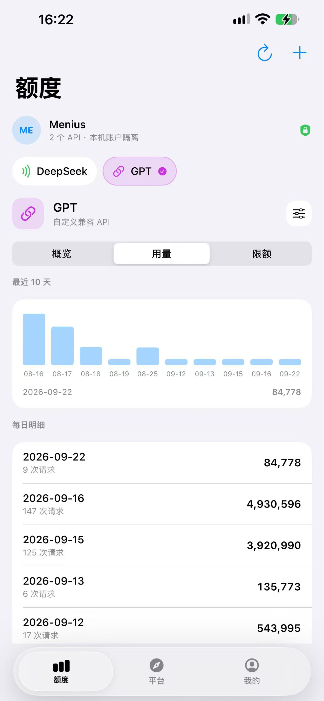
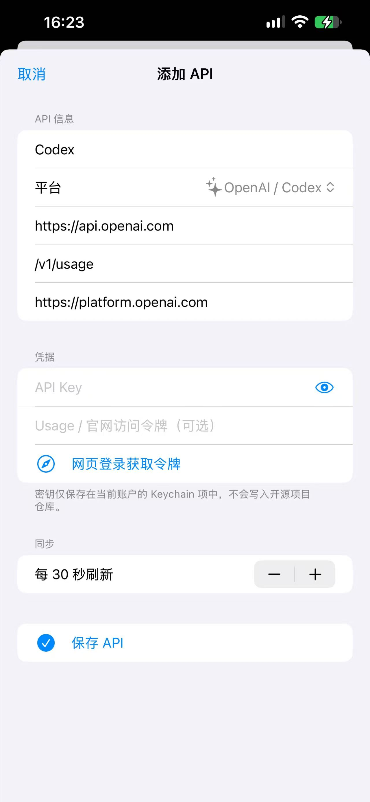
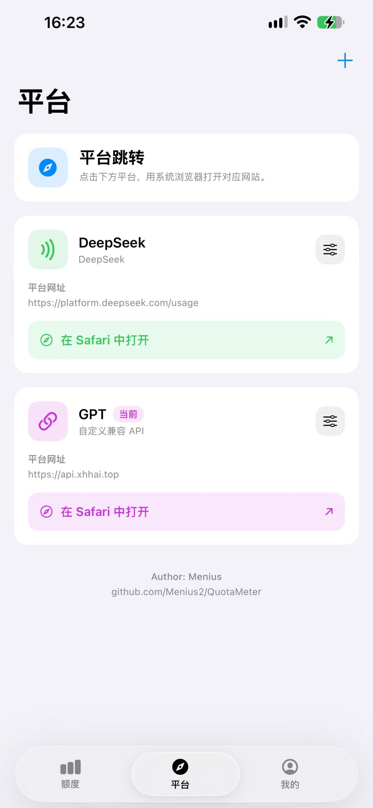
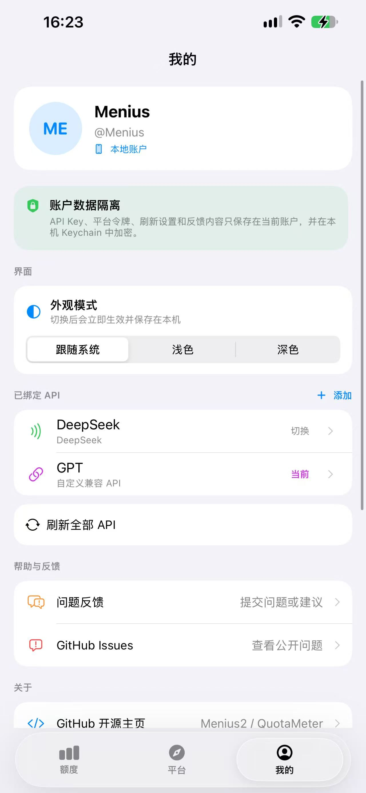
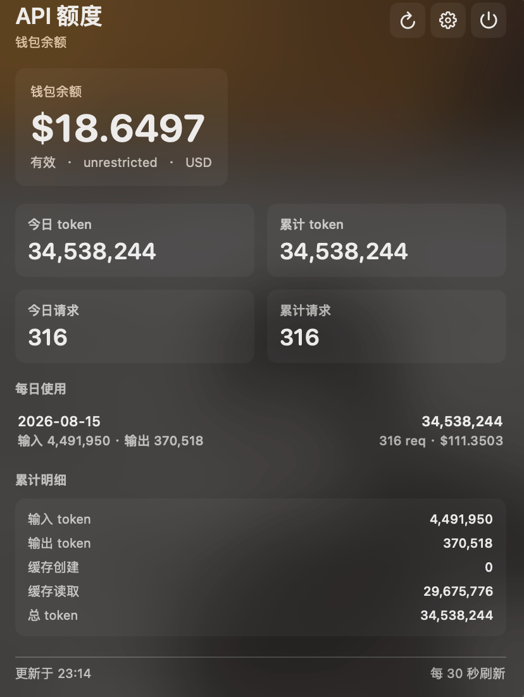
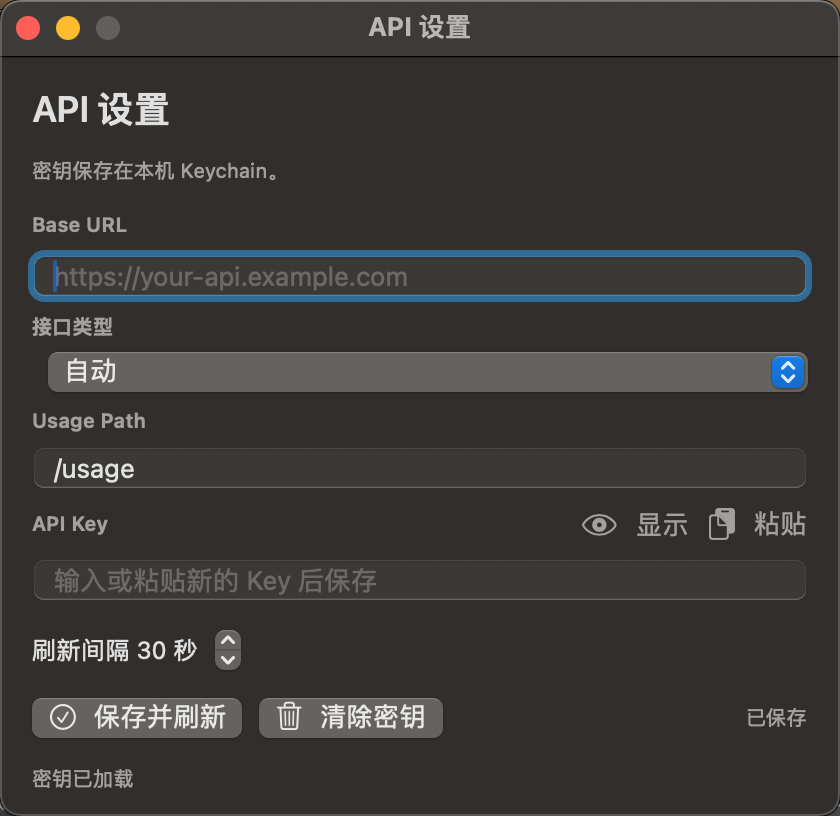

# QuotaMeter

QuotaMeter 是一个额度监控工具，用来查看 API 中转余额、Token 用量、每日使用记录和限额。

当前版本：**桌面版 v1.1.2 · iOS 版 v1.2.5**

项目提供三个版本：

- **macOS** — 菜单栏常驻
- **Windows** — 系统托盘常驻
- **iOS** — iPhone 应用，底部「额度 / 平台 / 我的」三 Tab

## 功能

- 常驻入口，点击即可展开详情（桌面版为菜单栏 / 托盘，iOS 版为三 Tab）
- 实时轮询刷新余额与用量
- 显示今日 / 累计 token、请求数、费用
- 显示每日使用记录
- 显示 rate limit / quota 信息
- 支持 OpenAI-compatible 接口
- 支持 OpenRouter
- 支持 DeepSeek API 余额查询
- 支持供应商 Usage / 官网访问令牌（按供应商配置）
- 内置适配器：兼容接口、OpenRouter、DeepSeek；兼容接口支持自定义完整 Usage URL
- 支持自定义 `Usage Path`
- 自动探测常见的 `/v1/usage`、`/usage`、`/api/usage`、`/user/usage`、`/account/usage`、`/billing/usage`、`/balance` 和 `/user/balance` 路径
- 对仅提供余额接口的供应商，可记录本机首次成功刷新之后观测到的余额消耗（不会伪造成 token 或请求数）
- 密钥保存到本机 Keychain（Windows 使用 DPAPI）
- 可选读取本地 `config.json`（仅桌面版）

iOS 版另外提供：最近 10 天用量柱状图、平台卡片一键跳转 Safari、浅色 / 深色外观切换、多 API 胶囊切换。详见 [ios/README.md](./ios/README.md)。

## 支持平台

| 平台 | 最低版本 | 形态 | 凭据存储 | 分发 |
| --- | --- | --- | --- | --- |
| macOS | macOS 13，Apple Silicon / Intel | 菜单栏 | Keychain | DMG |
| Windows | Windows 10 / 11，.NET 8 WinForms | 系统托盘 | DPAPI | EXE |
| iOS | iOS 17.0+，iPhone 竖屏 | 三 Tab | Keychain | 未签名 IPA |

macOS 建议使用 Xcode 15+ 或已安装 Command Line Tools。

## 安装

### 下载 Release

普通用户建议直接在 GitHub Releases 下载：

- macOS：下载对应 Release 中的 `QuotaMeter-macOS-v1.1.2.dmg`
- Windows：下载对应 Release 中的 `QuotaMeter-Windows-v1.1.2.exe`
- iOS：下载 [iOS Release](https://github.com/Menius2/QuotaMeter/releases/tag/ios-v1.2.5) 中的 `QuotaMeter-iOS-v1.2.5-unsigned.ipa`

### iOS 版安装

iOS 版本是**未签名 IPA**（开源项目没有 Apple 开发者证书），不能直接双击安装，需要用自己的证书重签或用自签工具侧载：

| 方式 | 说明 |
| --- | --- |
| Sideloadly | Windows / macOS 均可，用免费 Apple ID 签名后安装到手机，有效期 7 天 |
| AltStore / SideStore | 手机上自签，需要一台电脑完成首次配对 |
| TrollStore | 仅限支持的系统版本，签一次长期有效 |
| Xcode | 打开 `ios/QuotaMeter.xcodeproj`，用自己的 Team 签名后真机运行 |

安装后在 `设置 → 通用 → VPN 与设备管理` 中信任对应证书。

也可以直接使用仓库内的 `ios/QuotaMeter-iOS-v1.2.5-unsigned.ipa`，或从 `ios/` 目录自行构建，详见 [ios/README.md](./ios/README.md)。

### 方式一：从源码构建（macOS）

```bash
bash build.sh
open build/QuotaMeter.app
```

### 方式二：使用本地配置文件

把 `config-example.json` 复制为：

```bash
mkdir -p "$HOME/Library/Application Support/QuotaMeter"
cp config-example.json "$HOME/Library/Application Support/QuotaMeter/config.json"
```

然后填写你自己的 Base URL 和 API Key。不要把 `config.json` 提交到仓库。

### Windows 版本

Windows 用户可以在安装 .NET 8 SDK 的 Windows 电脑上运行：

```powershell
.\windows\build.ps1
```

生成的程序位于 `windows-dist/`。双击 `QuotaMeter.exe` 后，程序会出现在 Windows 系统托盘中。

仓库还提供了 GitHub Actions 模板 `windows/windows-build.yml.example`。复制到 `.github/workflows/windows-build.yml` 后，即可让 GitHub 自动构建 `win-x64` 版本。

Windows 版本的设置保存在：

```text
%APPDATA%\QuotaMeter\settings.json
```

API Key 使用当前 Windows 用户的 DPAPI 加密保存。不要把这个文件复制到 GitHub 或发送给其他人。

仓库中的 `.github/workflows/release.yml` 会在推送 `v*` 标签时自动构建 macOS DMG 和 Windows `win-x64` 单文件 EXE，并更新对应的 GitHub Release。

### iOS 版本

iOS 工程已附带可直接打开的 `ios/QuotaMeter.xcodeproj`（objectVersion 56，兼容 Xcode 14+），用 Xcode 打开选择自己的 Team 即可真机运行：

```bash
cd ios && open QuotaMeter.xcodeproj
```

`ios/project.yml` 是 [XcodeGen](https://github.com/yonaskolb/XcodeGen) 配置源，仅在改动工程结构时重新生成（xcodegen 2.46+ 会输出需要 Xcode 16+ 的新格式）。命令行构建未签名真机包的完整步骤见 [ios/README.md](./ios/README.md)。

## 使用步骤

### 桌面版

1. 打开 QuotaMeter
2. 点击菜单栏 / 托盘图标
3. 打开设置窗口
4. 填写 `Base URL`
5. 填写 `API Key`
6. 需要时选择接口类型和 `Usage Path`
7. 点击“保存并刷新”

### iOS 版

1. 打开 QuotaMeter，进入「额度」页
2. 点右上角 `+`，选择平台（DeepSeek / OpenAI 兼容等）
3. 填写 `Base URL`、`Usage Path`、`API Key`，需要时用「网页登录获取令牌」补充官网访问令牌
4. 点「保存 API」，回到额度页即开始轮询（默认 30 秒）
5. 在「平台」页可跳转官网，「我的」页可切换 API 与外观模式

### 适配器工作方式

QuotaMeter 将供应商接入分成三层：请求认证（API Key 或 Usage 访问令牌）、Usage 地址（相对路径或完整 URL）、以及响应字段归一化。这样只要供应商提供可访问的 Usage / 管理接口，就可以通过“兼容接口”接入，不需要为每个供应商复制一套界面。程序会识别常见的 `input_tokens`、`output_tokens`、`total_tokens`、`requests`、`cost`、`data`、`records` 和时间戳字段，并从每日记录汇总今日与累计数据。

`Base URL` 要填接口根地址，不要填网页版后台页面地址，例如 `/keys` 这类管理页。

### 常见填写示例

- 兼容中转：`Base URL = https://your-api.example.com`，接口类型选“兼容接口”，`Usage Path = /v1/usage`
- OpenRouter：接口类型选“OpenRouter”，`Base URL = https://openrouter.ai/api`
- DeepSeek：`Base URL = https://api.deepseek.com`，接口类型选“DeepSeek”，API Key 使用 DeepSeek API Key

API Key 只能访问供应商公开的 API；官网累计费用、Token 和请求数通常需要供应商自己的 Usage 接口或官网登录态。QuotaMeter 将访问令牌作为通用的可选凭据：兼容接口会优先用它请求用户填写的 Usage URL，DeepSeek 内置适配器会读取官网同源用量接口，其他供应商也可以通过自定义 Usage URL 接入。

访问令牌的获取方式由供应商决定。它是账户级敏感凭证，只保存在本机 Keychain，不要提交到配置文件或发给他人。若供应商没有公开 Usage 接口，程序无法仅凭 API Key 推导官网历史统计。

兼容接口会自动依次尝试用户填写的路径、`/v1/usage` 和 `/usage`。如果你的 Base URL 已经包含 `/v1`，请填写根地址或 `/v1` 均可，程序会避免生成 `/v1/v1/usage`。

自动模式会兼容字段的大小写、下划线/连字符/驼峰差异，并识别常见的余额、费用、token、请求数和每日记录字段；也会探测其他常见中转路径。不同平台的网页后台、登录会话和管理员接口仍不能通过普通 API Key 通用读取。遇到网页地址时，请改填 API 根地址；遇到平台没有公开用量 API 的情况，程序会明确提示，不会把网页 HTML 当成额度数据。

## macOS 打开未签名 App

如果系统拦截未签名应用，可以用下面任一方式：

1. 右键 `QuotaMeter.app`，选择“打开”
2. 到 `系统设置 -> 隐私与安全`，点“仍要打开”
3. 终端执行：

```bash
xattr -dr com.apple.quarantine build/QuotaMeter.app
```

## 截图

### iOS

| 概览 | 用量 | 添加 API |
| --- | --- | --- |
|  |  |  |

| 平台 | 我的 |
| --- | --- |
|  |  |

### macOS





如果要补充错误状态截图，可放入 `screenshots/error.png`。

## 仓库结构

```text
.
├── QuotaMeter.swift          # macOS 版本源码
├── windows/                  # Windows 版本源码（.NET 8 WinForms）
├── ios/                      # iOS 版本源码 + 未签名 IPA
├── screenshots/              # 截图（ios/ 子目录为 iPhone 截图）
├── .github/workflows/        # 桌面版发布流水线
└── build.sh                  # macOS 构建脚本
```

## 安全说明

- API Key 默认保存在本机 Keychain；Windows 版本使用当前用户 DPAPI 加密
- iOS 版本不同账户的 API Key、平台令牌、刷新设置与反馈内容互相隔离
- 不会额外启动后台 Helper 或登录项
- 退出 App 后，状态栏图标和轮询都会结束
- `config.json` 不要提交到仓库
- iOS 版通过系统 Safari 打开平台页面，App 内不注入网页脚本

## 开发说明

macOS：

```bash
bash build.sh
```

构建产物会输出到 `build/QuotaMeter.app`。

iOS：

```bash
cd ios
xcodebuild -project QuotaMeter.xcodeproj -scheme QuotaMeter -sdk iphoneos -configuration Release CODE_SIGNING_ALLOWED=NO
```

## 许可证

见 [LICENSE](./LICENSE)。
